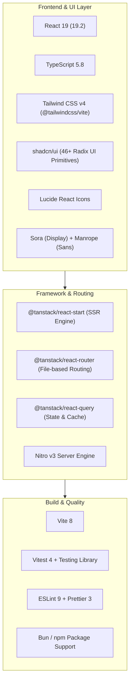

# 🚀 Kiji Technology OPC Pvt. Ltd. — Project Status & Architecture

---

## 📌 1. Project Overview & Objective

| Field                    | Details                                                                                                                                                                                      |
| :----------------------- | :------------------------------------------------------------------------------------------------------------------------------------------------------------------------------------------- |
| **Client / Company**     | **Kiji Technology OPC Private Limited**                                                                                                                                                      |
| **Tagline**              | _"Your Idea. Our Code. Endless Growth."_                                                                                                                                                     |
| **Design Inspiration**   | High-performance tech agency layout (inspired by `dotplus.in`), tailored with a custom brand identity (Sun Yellow, Leaf Green, Forest Green, and Clean White) avoiding any copyright issues. |
| **Development Platform** | Built & synced with [Lovable.dev](https://lovable.dev)                                                                                                                                       |
| **Live Preview**         | [bespoke-pixel-bloom.lovable.app](https://bespoke-pixel-bloom.lovable.app)                                                                                                                   |
| **Current Status**       | **Phase 1 Complete / Production Ready** (Core UI, SSR Routing, Design System, Responsive Layout & AI Sections fully implemented)                                                             |

---

## 🛠️ 2. Tech Stack (तकनीकी स्टैक)

### Detailed Tech Specifications:

1. **Framework & SSR Engine**:
   - **React 19** (`react: ^19.2.0`, `react-dom: ^19.2.0`): Latest React with concurrent rendering and ultra-fast component lifecycles.
   - **TanStack Start** (`@tanstack/react-start: 1.168.60`): Modern full-stack SSR framework built on top of Nitro and TanStack Router.
   - **TanStack Router** (`@tanstack/react-router: 1.170.41`): Type-safe file-based router with built-in client preloading (`routeTree.gen.ts`).
   - **Nitro Engine** (`nitro: 3.0.260603-beta`): High-performance server runtime targeting Cloudflare, Node.js, and edge deployments.
   - **TanStack Query** (`@tanstack/react-query: ^5.101.1`): Server cache layer, query invalidation, and async state management.

2. **Styling & Design System**:
   - **Tailwind CSS v4** (`tailwindcss: ^4.2.1`, `@tailwindcss/vite: ^4.2.1`): CSS-first styling with `@theme inline` and custom OKLCH color palettes.
   - **Color System**:
     - `Forest Green`: Dark sleek sections & contrast (`--forest`, `--forest-foreground`)
     - `Sun Yellow`: Vibrant CTA & highlight accent (`--sun`, `--accent`)
     - `Leaf Green`: Fresh tech vitality badges & borders (`--leaf`, `--primary`)
     - `Clean White / Off-white`: Crisp readability (`--background`, `--card`)
   - **Typography**: Google Fonts loaded via CDN:
     - `Sora`: Headings, logo, and bold displays.
     - `Manrope`: Readable body copy and UI labels.
   - **UI Component Library**: 46+ accessible, production-ready components from **shadcn/ui** powered by **Radix UI** (`@radix-ui/react-*`), `clsx`, and `tailwind-merge`.

3. **Build, Testing & Quality**:
   - **Vite 8** (`vite: 8.1.5`) & `@lovable.dev/vite-tanstack-config`.
   - **TypeScript 5.8** (`strict: true`, path alias `@/*`).
   - **Vitest 4** (`vitest: ^4.1.10`) with `jsdom` for router and unit testing.
   - **ESLint 9** + **Prettier 3** for code formatting and linting.

---

## 📂 3. "Kaun Kya Kar Raha Hai" — File & Module Breakdown

Yahan project ki har file aur module ka specific role detail kiya gaya hai:

### A. Core Engine & Server Routing (`src/`)

| File                 | Path                                                                 | Role & Functionality (Kya Kaam Karta Hai)                                                                                                            |
| :------------------- | :------------------------------------------------------------------- | :--------------------------------------------------------------------------------------------------------------------------------------------------- |
| **server.ts**        | [src/server.ts](file:///e:/website_kiji/src/server.ts)               | **Custom SSR Entrypoint**: Nitro/H3 server ke unhandled errors ko capture karta hai aur fallback 500 HTML render karta hai taaki server crash na ho. |
| **start.ts**         | [src/start.ts](file:///e:/website_kiji/src/start.ts)                 | **TanStack Start Middleware**: Server functions ke liye CSRF protection aur global error handling middleware inject karta hai.                       |
| **router.tsx**       | [src/router.tsx](file:///e:/website_kiji/src/router.tsx)             | **Router Factory**: TanStack Router aur React Query Client ko initialize karta hai; scroll restoration manage karta hai.                             |
| **routeTree.gen.ts** | [src/routeTree.gen.ts](file:///e:/website_kiji/src/routeTree.gen.ts) | **Auto Route Manifest**: File system routes (`/`, `/about`, `/services`, `/contact`) ko route tree me auto-compile karta hai.                        |
| **styles.css**       | [src/styles.css](file:///e:/website_kiji/src/styles.css)             | **Global Styles & Tokens**: Tailwind v4 theme, OKLCH colors, gradients, custom marquee animation, aur typography define karta hai.                   |

---

### B. Pages & Routes (`src/routes/`)

| Route File       | URL Path     | Features & Content (Kya Render Hota Hai)                                                                                                                                                                                                                                                                                                                                                                                                                                                                                                                                                                                                                                                 |
| :--------------- | :----------- | :--------------------------------------------------------------------------------------------------------------------------------------------------------------------------------------------------------------------------------------------------------------------------------------------------------------------------------------------------------------------------------------------------------------------------------------------------------------------------------------------------------------------------------------------------------------------------------------------------------------------------------------------------------------------------------------- |
| **\__root.tsx**  | _Root Shell_ | [src/routes/__root.tsx](file:///e:/website_kiji/src/routes/__root.tsx): Global HTML structure (`<html>`, `<head>`, `<meta>`, fonts, favicon, global layout shell, 404 Not Found component, aur Error Boundary).                                                                                                                                                                                                                                                                                                                                                                                                                                                                          |
| **index.tsx**    | `/` (Home)   | [src/routes/index.tsx](file:///e:/website_kiji/src/routes/index.tsx): **Main Landing Page**: • Hero section (Stats badge "350+ Projects", Primary CTA buttons) • Metric Cards (8+ yrs, 98% happy, 350+ projects, 30+ experts) • Infinite Tech Stack Marquee (React, Node, Flutter, AWS, Docker, AI, etc.) • About overview & value highlights • Core Services Grid • Dedicated AI & Automation Section • "Why Kiji" company vision • 5-Step Delivery Process • Industry Applications (Retail, Healthcare, Edu, Logistics, etc.) • Testimonials (ethically tagged as illustrative) • Interactive FAQ Accordion • Bottom Project Discussion CTA banner |
| **about.tsx**    | `/about`     | [src/routes/about.tsx](file:///e:/website_kiji/src/routes/about.tsx): Company background, Mission, Vision, aur 4 Core Values (_Innovation, Trust, Partnership, Speed_).                                                                                                                                                                                                                                                                                                                                                                                                                                                                                                                  |
| **services.tsx** | `/services`  | [src/routes/services/index.tsx](file:///e:/website_kiji/src/routes/services/index.tsx): 9 Core Offerings with granular deliverables (Web Dev, App Dev, Cloud/DevOps, E-Commerce, ERP/CRM, AI Automation, etc.) + Process & Automation sections.                                                                                                                                                                                                                                                                                                                                                                                                                                          |
| **products.tsx** | `/products`  | [src/routes/products/index.tsx](file:///e:/website_kiji/src/routes/products/index.tsx): Ready-built product catalogue grouped by category — Education Platforms (University/College/School websites), Institution Management Systems (University/College/School/Exam/Admission), Business & Property Systems (Flat/Society, Hospital, Hotel, HRMS) and AI & Automation.                                                                                                                                                                                                                                                                                                                  |
| **contact.tsx**  | `/contact`   | [src/routes/contact.tsx](file:///e:/website_kiji/src/routes/contact.tsx): Lead generation page: Contact info (Phone, Email, Location) aur Instant **WhatsApp Quote Form** jo user ka message encode karke direct WhatsApp conversation shuru karta hai.                                                                                                                                                                                                                                                                                                                                                                                                                                  |

---

### C. Shared Site Components & Central Data (`src/components/site/`)

| File              | Path                                                                                           | Role & Functionality                                                                                                                                                                                                                                                                                                                        |
| :---------------- | :--------------------------------------------------------------------------------------------- | :------------------------------------------------------------------------------------------------------------------------------------------------------------------------------------------------------------------------------------------------------------------------------------------------------------------------------------------ |
| **Layout.tsx**    | [src/components/site/Layout.tsx](file:///e:/website_kiji/src/components/site/Layout.tsx)       | Global layout wrapper jisme **TopBar** (phone/email/location), **Header** (Navigation + desktop **Products mega-menu** + Mobile hamburger/accordion menu), **Logo** (real company logo image), **Footer** (Quick links + Contact info), aur **Floating WhatsApp Quick Button** shamil hai.                                                  |
| **Expertise.tsx** | [src/components/site/Expertise.tsx](file:///e:/website_kiji/src/components/site/Expertise.tsx) | Shared sections jo Home aur Services dono pages par use hoti hain: 1. `AutomationSection`: AI Assistants, Connected Workflows, Document Intelligence, Human Oversight. 2. `ProcessSection`: 5-step delivery process (Discover → Design → Build → Test → Support).                                                                     |
| **Products.tsx**  | [src/components/site/Products.tsx](file:///e:/website_kiji/src/components/site/Products.tsx)   | Shared product components used on Home and `/products`: 1. `ProductsPreview`: Homepage teaser grid (6 featured products) + "View all products" CTA. 2. `ProductsGrid`: Full catalogue grouped by category, used on the Products page. 3. `ProductCard`: Single product card with anchor id for deep-linking from the nav dropdown. |
| **data.ts**       | [src/components/site/data.ts](file:///e:/website_kiji/src/components/site/data.ts)             | **Single Source of Truth**: `contact` (phone/email/address), `services`, `products` (13 items across 4 categories), 14 tech stack tags, aur 5 process steps. Content change karne ke liye sirf yahi ek file edit karni hoti hai.                                                                                                            |

---

### D. Utility & Error Telemetry (`src/lib/`)

| File                           | Path                                                                                             | Role & Functionality                                                                                |
| :----------------------------- | :----------------------------------------------------------------------------------------------- | :-------------------------------------------------------------------------------------------------- |
| **error-capture.ts**           | [src/lib/error-capture.ts](file:///e:/website_kiji/src/lib/error-capture.ts)                     | Server-side SSR exceptions aur h3 errors ko intercept karke detailed stack trace capture karta hai. |
| **lovable-error-reporting.ts** | [src/lib/lovable-error-reporting.ts](file:///e:/website_kiji/src/lib/lovable-error-reporting.ts) | Runtime errors ko Lovable editor telemetry aur tracking system me forward karta hai.                |
| **error-page.ts**              | [src/lib/error-page.ts](file:///e:/website_kiji/src/lib/error-page.ts)                           | Pure standalone HTML fallback error page (500 Server Error) generate karta hai.                     |
| **utils.ts**                   | [src/lib/utils.ts](file:///e:/website_kiji/src/lib/utils.ts)                                     | `cn()` helper class combining `clsx` aur `tailwind-merge`.                                          |

---

### E. UI Primitives (`src/components/ui/`)

- [src/components/ui/](file:///e:/website_kiji/src/components/ui/) me **46 modular UI components** shamil hain (e.g. `button.tsx`, `accordion.tsx`, `card.tsx`, `dialog.tsx`, `carousel.tsx`, `form.tsx`, `sheet.tsx`, `sonner.tsx`, etc.).
- Yeh **Radix UI** primitives par based hain jo accessibility (ARIA compliance), keyboard navigation, aur sleek animation ensure karte hain.

---

## 📊 4. Current Status Checklist

| Feature / Module                   |   Status    | Verification Notes                                                                                                                                                                                         |
| :--------------------------------- | :---------: | :--------------------------------------------------------------------------------------------------------------------------------------------------------------------------------------------------------- |
| **Brand Identity & Colors**        | ✅ Complete | Yellow, Green, White palette implemented with OKLCH tokens in [styles.css](file:///e:/website_kiji/src/styles.css).                                                                                        |
| **Responsive Navigation & Header** | ✅ Complete | Desktop nav + Mobile hamburger drawer navigation working in [Layout.tsx](file:///e:/website_kiji/src/components/site/Layout.tsx).                                                                          |
| **Homepage Architecture**          | ✅ Complete | Hero, Stats, Tech marquee, Services, AI Automation, Process, FAQs, and CTA in [index.tsx](file:///e:/website_kiji/src/routes/index.tsx).                                                                   |
| **Services Catalog**               | ✅ Complete | 9 distinct services with specific deliverables detailed in [services/index.tsx](file:///e:/website_kiji/src/routes/services/index.tsx) and [data.ts](file:///e:/website_kiji/src/components/site/data.ts). |
| **About Us Page**                  | ✅ Complete | Mission, Vision, and Core values established in [about.tsx](file:///e:/website_kiji/src/routes/about.tsx).                                                                                                 |
| **Contact & Lead Flow**            | ✅ Complete | Direct WhatsApp quote generator in [contact.tsx](file:///e:/website_kiji/src/routes/contact.tsx).                                                                                                          |
| **Testimonial Integrity**          | ✅ Complete | Labelled transparently as illustrative placeholders per ethical agency standards.                                                                                                                          |
| **SEO & Social Metadata**          | ✅ Complete | OpenGraph, Twitter Cards, Meta titles, and descriptions configured across all routes.                                                                                                                      |
| **Automated Routing Test**         | ✅ Complete | [src/test/app-routing.test.tsx](file:///e:/website_kiji/src/test/app-routing.test.tsx) present in test suite.                                                                                              |

---

## 🎯 5. Next Recommended Steps (Agla Kya Karna Hai)

1. **Real Contact Details:** ✅ Done — phone `+91 94303 88982`, email `kijitechnology@gmail.com` aur registered address (Ward No. 16, Hanuman Tikri, Deoghar, Jharkhand 814112) ab [src/components/site/data.ts](file:///e:/website_kiji/src/components/site/data.ts) me single source of truth ke roop me set hai aur Header, Footer, Contact page aur WhatsApp links sab yahi se read karte hain.
2. **Products Catalogue:** ✅ Done — `/products` page aur nav mega-menu me University/College/School Websites, University/College/School/Exam/Admission Management Systems, Flat/Society, Hospital, Hotel, HRMS aur AI Automation Suite add kiye gaye hain.
3. **Connect Custom Domain:**
   - Lovable dashboard me jakar `kijitechnology.in` domain point karna (DNS A/CNAME records add karke).
4. **Verify MCA Registration Details:**
   - Company ka CIN (Corporate Identification Number) website footer ya About page par add karna, jab available ho — yeh Indian OPC companies ke liye standard professional practice hai.
5. **Lead Database Integration (Optional):**
   - Agar WhatsApp ke alawa quote requests ko database (Supabase / PostgreSQL) me bhi save karna ho, toh API route ya webhook configure kiya ja sakta hai.
6. **Individual Product Pages (Optional):**
   - Abhi saare products ek hi `/products` page par (category-wise + anchor links) hain. Future me har flagship product (jaise School Management System) ke liye alag dedicated landing page bhi banaya ja sakta hai agar SEO/marketing ke liye zaroorat ho.
7. **Chat Widget, SEO & Blog:** ✅ Done — [src/components/site/ChatBot.tsx](file:///e:/website_kiji/src/components/site/ChatBot.tsx) (rule-based FAQ assistant with WhatsApp handoff), [src/components/site/StructuredData.tsx](file:///e:/website_kiji/src/components/site/StructuredData.tsx) (JSON-LD), `public/sitemap.xml`, and a `/blog` section with 3 articles are all live.
8. **Analytics:** Scaffolded in [src/components/site/Analytics.tsx](file:///e:/website_kiji/src/components/site/Analytics.tsx) — inactive until you set `VITE_GA_MEASUREMENT_ID` (copy `.env.example` to `.env` with your GA4 measurement ID).
9. **Still outstanding (cannot be done from code):** real company CIN (not found in MCA registry — do not fabricate), Google Business Profile listing (external Google account action), and real client testimonials/case studies (ethical placeholder policy in `AGENTS.md`).

10. **Service & product detail pages:** ✅ Done — har service aur product ka apna detail page hai (`/services/:slug`, `/products/:slug`). Content ek hi file me hai: [src/components/site/details.ts](file:///e:/website_kiji/src/components/site/details.ts); layout: [src/components/site/DetailPage.tsx](file:///e:/website_kiji/src/components/site/DetailPage.tsx). Naya product/service jodne ke liye `data.ts` me entry + `details.ts` me usi slug ka content add karein, aur `public/sitemap.xml` update karein.

11. **Technologies, Hire Developers, Student products & legal pages:** ✅ Done — [/technologies](file:///e:/website_kiji/src/routes/technologies.tsx) (data: [tech-stack.ts](file:///e:/website_kiji/src/components/site/tech-stack.ts)), [/hire-developers](file:///e:/website_kiji/src/routes/hire-developers.tsx), StudyMate + Online Test Platform product pages, [/privacy-policy](file:///e:/website_kiji/src/routes/privacy-policy.tsx), [/terms](file:///e:/website_kiji/src/routes/terms.tsx), og:image aur security headers ([server.ts](file:///e:/website_kiji/src/server.ts)). Privacy/Terms ko legal adviser se review karwa lein.
